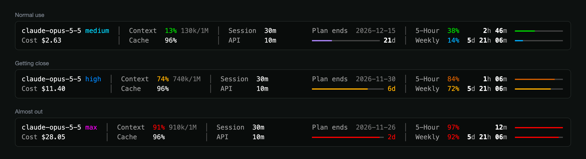

# Claude Code status line

A two-line status line for [Claude Code](https://claude.com/claude-code) on macOS. It shows the
model, context, cache and cost on the left, and your plan end date, 5-hour limit and weekly limit
with progress bars on the right edge of the terminal.



## What it shows

| Part | Meaning |
|---|---|
| Model, effort, cost | Current model, effort level and the session cost |
| Context, Cache | Context window used, prompt cache hit ratio |
| Session, API | Time since the session started, time spent waiting for the model |
| Plan ends | Days left and a bar of the month used (optional, see below) |
| 5-Hour, Weekly | Percent used, time until reset and a bar for each limit |

Limits turn yellow at 70%, orange at 80% and red at 90%. The plan turns yellow in the last 7 days
and red in the last 3. Until the first reply of a session, the last saved limits are shown. A limit
whose window is over shows 0% until Claude Code reports the next one.

The block on the right follows the window width. Use a window of about 135 columns or more.

## Requirements

- macOS (the script uses the BSD `date` command)
- `jq`: `brew install jq`
- Claude Code with a Pro or Max plan for the limits; other plans show a dash

## Install

With Homebrew:

```sh
brew install amirhp-com/tap/claude-code-statusline && claude-code-statusline install
```

Or without it:

```sh
curl -fsSL https://raw.githubusercontent.com/amirhp-com/claude-code-statusline/main/install.sh | bash
```

Both set `statusLine` in `~/.claude/settings.json` and leave the rest of the file alone. The file as
it was is kept as `settings.json.before-statusline`.

With the second way, the script is `~/.claude/claude-code-statusline.sh`: use that path instead of
`claude-code-statusline` in the commands below, and run the same line again to update.

| Command | Does |
|---|---|
| `claude-code-statusline install` | Turns it on |
| `claude-code-statusline install --jalali` | Same, with the plan date in the Jalali calendar |
| `claude-code-statusline plan-ends 2026-12-20` | Sets the plan end date |
| `claude-code-statusline plan-ends off` | Hides the plan block |
| `claude-code-statusline uninstall` | Puts your previous status line back |

Run `uninstall` before `brew uninstall claude-code-statusline`.

## Plan end date

Claude Code does not report when your plan ends, so you set it with `plan-ends` (a Gregorian date)
and change it after each renewal. The bar covers the month before that date.

## Files and privacy

The status line sends nothing anywhere. It reads the JSON that Claude Code passes to it and keeps its
files in `~/.claude/state`: the last limits, the plan end date and your previous status line.

## License

MIT © 2026 [AmirhpCom](https://amirhp.com). Not affiliated with Anthropic.
